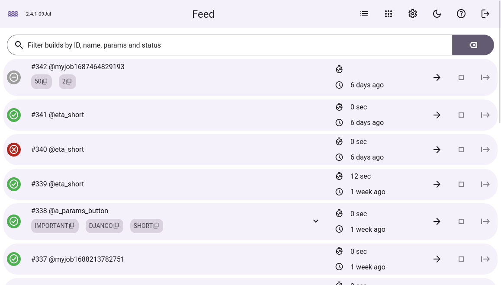

# wakeci

### What is it?

wakeci is an automation tool which helps to execute repetitive tasks



### Features

-   simple job configuration using YAML files with Ansible inspired syntax
-   easy to install - just download a binary file from Releases
-   automatic Let's Encrypt SSL certificates
-   parameterized builds, artifacts, intervals and timeouts - see job configuration example below
-   API keys limited to reading, running or editing jobs, and to the jobs you pick
-   no plugins, no extensive configuration - focus on your project instead!

### Job configuration example

> See full description [here](https://github.com/jsnjack/wakeci/blob/master/src/frontend/src/assets/configDescription.yaml)

```yaml
desc: Build and release wake application
params:
    - VERSION: master

tasks:
    - name: Clone repository
      run: git clone git@github.com:jsnjack/wakeci.git --recursive

    - name: Checkout version
      run: sh ${WAKE_CONFIG_DIR}utils/checkout.sh wakeci ${VERSION}

    - name: Install npm dependencies
      run: cd wakeci/src/frontend && npm install

    - name: Build application
      run: cd wakeci && make build

    - name: Create a release on github
      run: python ${WAKE_CONFIG_DIR}utils/release_on_github.py -f wakeci/bin/wakeci -r jsnjack/wakeci -t "v`cd wakeci && monova`"

timeout: 10m

on_failed:
    - name: Send notification to Slack
      run: >-
          python ${WAKE_CONFIG_DIR}utils/notify_slack.py
          -t "Job ${WAKE_JOB_NAME} has failed at '${WAKE_FAILED_TASK_NAME}' <${WAKE_URL}build/${WAKE_BUILD_ID}|#${WAKE_BUILD_ID}>"
          -k error

on_finished:
    - name: Send notification to Slack
      run: >-
          python ${WAKE_CONFIG_DIR}utils/notify_slack.py
          -t "New wake version `cd wakeci && monova` <${WAKE_URL}build/${WAKE_BUILD_ID}|#${WAKE_BUILD_ID}>"
          -k ok
```

### How to use it?

```
Usage of ./bin/wakeci:
  -V	Print the version and exit (shorthand).
  -compactdb
    	Reclaim space in the database which is no longer used
  -config string
    	Configuration file location (default "Wakefile.yaml")
  -version
    	Print the version and exit.
```

#### Wakefile.yaml format

```
# Port to start the server on (default "8081")
port: 8081
# Hostname for autocert (active only when port is 443) and the default
# single sign-on URLs
hostname: ""
# Working directory (default ".wakeci/")
workdir: ./wakeci
# Configuration directory - all your job files (default "./"). Every .yaml file
# in it can be opened as a job, so keep this file and the secrets file outside it
jobdir: ./jobs
# Path to the file with secrets
secretsfile: ./secrets.yaml
# Scheduled jobs (via `interval` field) will use this timezone, if not specified
# in the job configuration
timezone: Europe/Amsterdam
# Optional single sign-on through a SAML identity provider such as Google
# Workspace, next to the password. See "Single sign-on" below.
sso:
  # Metadata file downloaded from the identity provider. Keep it outside jobdir
  idpmetadata: ./GoogleIDPMetadata.xml
  # Comma-separated groups allowed to log in, as named in the "groups" attribute
  groups: Developers, Ops
  # Where the identity provider posts the response.
  # Defaults to https://<hostname>/auth/sso/acs
  acsurl: ""
  # Identifies wakeci to the identity provider. Defaults to https://<hostname>
  entityid: ""
```

#### Single sign-on

To set it up with Google Workspace, add a custom SAML app in the Google Admin
console (Apps, Web and mobile apps, Add app, Add custom SAML app):

1. Download the IdP metadata and point `sso.idpmetadata` at the file.
2. Service provider details: ACS URL `https://<hostname>/auth/sso/acs`, Entity
   ID `https://<hostname>`, Name ID format `EMAIL`, Name ID
   `Basic Information > Primary email`.
3. Attribute mapping: under "Group membership", pick the groups and set the app
   attribute to `groups`. List the same group names in `sso.groups`.
4. User access: turn the app on for those groups.

Only accounts of your own Workspace can sign in to a custom SAML app, and of
those only members of a group in `sso.groups` can log in; a rejected login
logs the groups wakeci received. Opening wakeci from the Google apps menu
starts a normal login. SSO sessions last 12 hours, password sessions 5 days.
API calls use an API key (see below) or Basic auth with the password.

Serve wakeci over HTTPS, or on localhost: Google posts the response from
another site, which browsers only allow with a `Secure` login cookie. When
Google renews its certificate, download the metadata again and restart wakeci.

#### API keys

Scripts and other tools can call the API with a key instead of the password.
Create one on the API keys page (the key icon), choose what it can do and on
which jobs, and send it as a Bearer token:

```bash
curl -X POST -H "Authorization: Bearer wk_..." https://<hostname>/api/job/deploy/run
```

| Scope | Allows |
|---|---|
| `read` | the job list, job files, the feed, builds, task logs and artifacts |
| `run` | running jobs, and aborting, starting or flushing their builds |
| `write` | creating, editing, deleting, enabling and disabling jobs |

A key covers all jobs, including jobs added later, or only the jobs you pick
and the ones whose names match a pattern such as `test_*`. `write` always
covers all jobs: jobs run commands on the server, so a key that can edit one
can reach everything wakeci can. The job list and the feed only show the key's
jobs. Keys never open the settings, key management, login or the websocket.
Run parameters sent with a key can't reference a secret (`{{ secrets.NAME }}`)
or contain quotes or line breaks, and in builds a key starts, `build.env`
values aren't turned into secrets. A `run` key still chooses the job's parameters, so treat
them as untrusted input: quote them, and don't let one pick where a job sends
a secret, such as the URL a token is posted to.

The key is shown once, when it is created; wakeci only stores a hash of it.
Revoking a key stops it at once. Keys don't depend on the password, and
survive restarts.

Each key records who created it. Logged in with the admin password, the API
keys page shows every key and who made it, and can revoke all keys of a
person, which also signs them out. People who sign in with SSO only see and
revoke the keys they created, and only the admin password can change the
password. Everything else is open to them, including editing jobs, which
runs commands on the server, so only give SSO access to people you trust.

wakeci can't tell on its own that a Google account is gone, so when someone
leaves:

1. Suspend or delete their Google account, so they can't sign in again.
2. On the API keys page, logged in with the admin password, pick them under
   "Created by" (it lists everyone with a key or signed in) and click
   "Revoke access". That signs them out, closes their live updates and
   revokes their keys.
3. If they knew the admin password, change it and restart wakeci to invalidate
   existing password sessions. This signs everyone out and interrupts running
   builds. Then revoke all keys created with the admin password, since those
   keys cannot be attributed to a person and survive password changes and restarts.

> Default password is `admin`. Don't forget to immediately change it!

#### Audit log

wakeci writes one line for every sign-in and every change, saying who did
what, from where and whether it worked. The lines go to stderr with the other
logs, whatever `--debug` says, and start with `msg=audit`. Under systemd,
`journalctl -u wakeci | grep msg=audit` shows them; ship stderr to your log
system to read several servers together.

```
time=2026-11-05T11:02:03Z level=INFO msg=audit server=ci.example.com event=login.sso outcome=ok auth=sso user=alice@example.com groups="[\"Developers\"]" ip=198.51.100.4 logID=Xk2pQ
time=2026-11-05T11:02:41Z level=INFO msg=audit server=ci.example.com event=build.run outcome=ok auth=sso user=alice@example.com job=deploy build=1234 params="[\"TARGET\"]" status=200 method=POST path=/api/job/deploy/run ip=198.51.100.4 logID=b7RtM
time=2026-11-05T11:05:10Z level=INFO msg=audit server=ci.example.com event=login.sso outcome=rejected user=bob@example.com reason="in no allowed group" groups="[\"Marketing\"]" ip=203.0.113.8 logID=Qe9Zs
```

| Field | Meaning |
|---|---|
| `server` | `hostname` from the config, or the machine's name |
| `event` | what happened, see below |
| `outcome` | `ok`, `failed`, or `rejected` for a login refused by group or revoke; `status` is the HTTP status |
| `auth` | how the request signed in: `password` (session from the admin password), `sso`, `basic` (Basic auth with the password) or `apikey` |
| `user` | the SSO email; for an API key, the email of who created it. Empty for the admin password, which isn't a person |
| `apiKey` | the ID of the API key used |
| `ip` | the address the connection came from |
| `forwardedFor` | the `X-Forwarded-For` header, if the request had one. Anyone can send it: behind a proxy, `ip` is the proxy and this is what it passed on; without one, it can be made up. A long header keeps its start and its end, where a proxy adds the address it saw |
| `logID` | the same ID as the request's `request completed` line |

| Events | |
|---|---|
| `login.password`, `login.basic`, `login.sso`, `login.apikey` | sign-ins, including ones the server failed to check; failures other than a wrong password have a `reason`, SSO logins the `groups` the identity provider sent, and the failure that blocks an address for too many attempts has `blocked=true` |
| `logout` | |
| `build.run`, `build.abort`, `build.start`, `build.flush` | with `job` and `build`; a run lists the job parameters it set in `params` (names only) and how many other names it sent in `ignoredParams`, and a scheduled one has `trigger=interval` and no user |
| `job.create`, `job.edit`, `job.delete`, `job.set_active` | with `job`; a create that failed after writing the job file has `fileCreated=true`, since the file can still be added as a job |
| `settings.change` | the new values, and `passwordChange=true` if the password was sent |
| `key.create`, `key.revoke`, `access.revoke` | the key, its scopes, `allJobs`, and otherwise its `jobs` and `patterns` as JSON lists; revoking someone's access names the `person` and how many `sessions` and `keys` it ended. Sessions end first, so a revoke that failed may still have `sessions` |

Refused attempts are recorded too, e.g. an SSO user trying to change the
password, or an API key without the `run` scope trying to run a job. The log
never contains passwords, tokens, secrets or the values of run parameters,
nor parameter names the job doesn't have, which can hold anything (`curl -d`
with a JSON body sends the whole body as one name).
Values longer than 1024 bytes are cut and end in `...`. Lists of names
(`groups`, `params`, `jobs`, `patterns`) are JSON, so a name with a comma
keeps its boundaries; they stay valid within 1024 bytes by leaving names out,
and say how many in `groupsOmitted`, `paramsOmitted` and so on. A request
whose handler crashed is recorded as failed with status 500 and `panic=true`.

Reading isn't an audit event, but the `request completed` line of every API
call, task log and artifact names who made it the same way. The app's pages
themselves are public files without data, so their lines name no one; the
data a page shows comes from API calls. Requests from an address blocked for
too many failed attempts are only in those lines. Job files changed on the
server's disk, not through wakeci, aren't attributed to anyone.

### API documentation

See full description [here](https://github.com/jsnjack/wakeci/blob/master/API.md)

### Development

Requires golang 1.18+

#### How to install golang 1.18+

```bash
go get golang.org/dl/go1.18.2
/home/$USER/go/bin/go1.18.2 download
# Manage different versions with `alternatives`
sudo alternatives --install /usr/bin/go go /home/$USERNAME/go/bin/go1.18.2 10
# Switch between different go versions
sudo alternatives --config go
```

> Golang downloads page https://golang.org/dl/

#### Install dependencies

```bash
sudo dnf install entr
go install github.com/swaggo/swag/cmd/swag@latest

# cd src/frontend
npm install
```

#### Start application

```bash
# frontend
make runf

# backend
make runb
```

#### End-to-end tests

The Playwright suite runs against isolated production backends in parallel.
It requires Google Chrome. Each worker gets a temporary database, job directory,
test secrets, and an available port; it does not use your running server.

```bash
make testprod                             # build, then run the full E2E suite
make testprod E2E_ARGS="--workers=4"       # choose the worker count
make testprod E2E_ARGS="e2e/feed.spec.js"  # run one spec
make testdev                              # run with visible browsers
make check                                # full project validation, including E2E
make testreport                           # open the last HTML report from the repo root

# After building, rerun tests without rebuilding:
cd src/frontend
npm test
npm run test:open                         # interactive Playwright UI
npm run test:report                       # inspect the last HTML report
```

The default worker count is half the available CPUs, capped at ten. On a Ryzen
AI 9 HX PRO 370 with 24 CPU threads, ten workers had the fastest measured median
(13.7 seconds over nine full-suite runs); twelve took 15.3 seconds and twenty-four
took 17.9 seconds.

Tests retain screenshots, browser traces, and backend logs on failure in
`src/frontend/test-results/`. To use Playwright's Chromium instead of Chrome,
install it explicitly with `npx playwright install chromium` and run with
`E2E_BROWSER_CHANNEL=chromium`.

#### Update all outdated npm packages

```bash
npm outdated --json | jq -r 'keys[]' | xargs -I % npm i %@latest --save
```

#### Update all outdated go packages

```bash
GOWORK=off go-mod-upgrade
```
